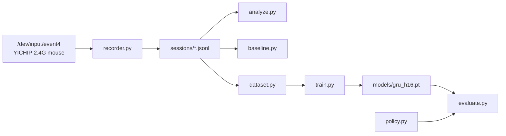

# MouseScrollFixer — Wiki

> Entries cite their evidence as `t3:<thread_id>` (open with `t3_thread_read`), `antigravity:<conv-id>` (`~/.gemini/antigravity*/brain/<conv-id>/`), a commit hash, or `code`. If an entry is vague, conflicts with another entry, or does not match what you see, open its source before trusting either.

Goal: suppress wrong-direction wheel ticks in real time, most of all the "end of scroll reverse", with a rule or a tiny model placed between the evdev device and the compositor.

## File map

| File | Role |
|---|---|
| [recorder.py](recorder.py) | curses UI; a reader thread on the evdev fd; modes `d`/`u`/`s`/`r` |
| [analyze.py](analyze.py) | Per-session stats: against-intent rate, bursts, reversal delays, cue reaction |
| [baseline.py](baseline.py) | Hold-and-confirm rule filter, grid over M (notches) × W (ms) |
| [dataset.py](dataset.py) | `FeatureExtractor`: 5 causal features `[sign, log_mag, log_gap, same_sign, log_burst_run]`, labels (`1` = jitter), and `synthetic_reversals` |
| [train.py](train.py) | Trains the streaming GRU (in=5, h=16, 1,121 params, AdamW + cosine LR + synthetic reversals). Saves leave-session-out ckpt to `models/`; `--all --export-base` exports `weights/base.npz` |
| [policy.py](policy.py) | Output policies: `drop` deletes suppressed reports; `hold_release` (default 100 ms, per-item expiry) holds them and releases on a confirmed reversal |
| [evaluate.py](evaluate.py) | Validation scores per policy plus a per-reversal breakdown (`thr=0.7`, `hold_ms=100`). Start here when judging a model |
| [app.py](app.py) | Calibration TUI + closed-loop `--against-model [--label TAG]` failure audit (`mode: "model_test"` saved as `sessions/*_against_model*.jsonl`, excluded from `train.py`/`evaluate.py`, opt-in for `finetune.py` via `include_in_train`) |
| [finetune.py](finetune.py) | NumPy fine-tune from `weights/base.npz` (AdamW `wd=1e-2` + leak-free synthetic reversals); time split 75/25 per session + opt-in `model_test` sessions; keeps the best held-out epoch |
| [gru_np.py](gru_np.py) | NumPy GRU: streaming step (via `dataset.FeatureExtractor`), BPTT, Adam/AdamW. Same parameter layout as torch (gates r,z,n) |
| [devices.py](devices.py) | Wheel-mouse discovery from `/proc/bus/input/devices`; by-id path; `profiles/<slug>.npz` |
| `weights/base.npz` | Committed base weights (exported via `train.py --all --export-base` across all 6 sessions). Every fine-tune starts here |
| [live.py](live.py) | Live filter (`thr=0.7`, `hold_ms=100`, per-item expiry): EVIOCGRAB on the real mouse, a uinput virtual copy, NumPy single-step GRU, hold/release. Line-buffers wheel decisions (`buffering=1`) to `live_logs/` (gitignored) |
| `sessions/` | The dataset. One JSONL file per recording |

## Fast path

### Access is lost when you switch mice
* **Symptom**: after swapping receivers, `live.py` says "no read access" for a mouse that worked before.
* **Reasoning trace**: `setfacl` sets the ACL on the device node. Unplugging destroys the node, and a re-plug creates a fresh `root:input 660` node without the ACL. The same applies to every reboot.
* **Resolution**: `linux/install_mouse_access.sh` installs `/etc/udev/rules.d/72-mousescrollfixer.rules`. It grants a read-only ACL to the user on every `ID_INPUT_MOUSE` event node at plug-in, excluding anything that is also `ID_INPUT_KEYBOARD`. Read-only on purpose: the common shortcut `TAG+="uaccess"` grants rw, and write access to an evdev node allows injecting events. `/dev/uinput` stays manual (resets on reboot) by the owner's choice, because it allows keystroke injection. *(Source: t3:1139490a-2822-4da5-b9ab-0c6bf8b3304d · bc42f03)*

- Access: `sudo setfacl -m u:$USER:r /dev/input/event4`, a read-only ACL on that node only. It is lost on replug or reboot. The user is deliberately **not** in the `input` group, because that group can read the keyboard too. *(Source: t3:1139490a-2822-4da5-b9ab-0c6bf8b3304d)*
- Live filter also needs `sudo setfacl -m u:$USER:rw /dev/uinput`. This lets any of your processes inject input; revoke after testing with `sudo setfacl -x u:$USER /dev/uinput`. *(Source: t3:1139490a-2822-4da5-b9ab-0c6bf8b3304d · 07251b5)*
- Stable path: `/dev/input/by-id/usb-YICHIP_2.4G_Receiver_b120300001-if01-event-mouse`. The `-event-if01` sibling is the consumer-control interface (event6), not the mouse.
- Quick probe without the UI: `python3 -c "import recorder,time; r=recorder.Reader(recorder.DEVICE); r.start(); r.start_session(armed=False); time.sleep(3); print(len(r.stop_session()))"`

## Dependency tiers

| Tier | Needs | Files |
|---|---|---|
| Record / analyze | stdlib | recorder, analyze, baseline, dataset, policy |
| App / fine-tune / live | + NumPy | app, finetune, gru_np, live, devices |
| Research | + torch (`uv run --group research`) | train, evaluate |

- `gru_np.loss_and_grads` must match torch autograd. Checked to `< 1e-16` (`max_diff = 8.3e-17`) on every parameter of the 5-feature model. Re-run that check after changing the model or loss. *(Source: code)*
- Sessions are tied to a mouse by `meta.device` (the stable by-id path). Fine-tune and the app's counters filter on it. *(Source: code)*
- Profiles resolve as `profiles/<slug(device)>.npz`, else `weights/base.npz` (live.py and app). *(Source: code)*
- True hi-res mice (hi-res ≠ 120 × notch) are filtered at notch granularity only. live.py warns about it. *(Source: code)*

## Live filter rules

- The grab is held on the evdev fd. When the process exits or crashes, the kernel drops it and the real mouse works directly again. No cleanup is needed for safety. *(Source: code)*
- Each SYN frame: non-wheel events pass unchanged; `REL_WHEEL` and `REL_WHEEL_HI_RES` are both removed and re-emitted from the policy's output as `(sum, sum*120)`. Forwarding hi-res alone would bypass the filter, because libinput scrolls from hi-res. *(Source: code)*
- The model sees **every raw** wheel report, suppressed ones included. That matches the offline features. *(Source: code)*
- `Streaming` (NumPy) must match the torch GRU. Verified to within `1.3e-7` (`< 5e-6`) in probability, with identical `hold_release` (100 ms, per-item expiry) output on all validation sessions. Re-verify after changing the model architecture or features. *(Source: code)*

- **Pause reset**: when a report comes `RESET_GAP_MS` (500 ms) or more after the previous one, `FeatureExtractor.pause_reset` clears the extractor and both live models (`gru_np.Streaming`, `PureGRU`) zero the hidden state. The report is judged like the first report of a session (p ≈ 0.2–0.3, so it passes). Replayed on all live logs: real reversals after a ≥ 0.5 s pause, first report blocked 60% → 0%, notches lost 451 → 32; stray first reports after a pause now always pass (174 cases, was 24%). Cued and training sessions moved by ≤ 1 notch. Training (`dataset.features`) does **not** reset, so a fresh state is rare in training; resetting there too is the next step if post-pause behaviour needs tuning. `PureGRU` still matches `Streaming` to 4e-16 with the reset. *(Source: t3:50e11e17-bf24-499d-ae5e-43ccd65587c1 · ae7b0c1)*

## Windows filter (live_windows.py)

Ship it with `python3 package_windows.py` → `dist/MouseScrollFixer-windows.zip` (gitignored). The zip holds `live_windows.py`, `dataset.py`, `policy.py`, the JSON profiles, `start.bat`, `test.bat` and `README.txt`. If `live_windows.py` gains an import, add the file to `FILES` in `package_windows.py`. The zip's README.txt and README.md both say the Windows version is untested; drop those notes once it has run on a real Windows machine. *(Source: t3:1139490a-2822-4da5-b9ab-0c6bf8b3304d · bc2c5a6)* *(Source: t3:1139490a-2822-4da5-b9ab-0c6bf8b3304d · 3428285)*

Calibrate and fine-tune on Linux; Windows only runs the filter. Profiles travel as JSON
(`export_windows.py` → `windows/profiles/*.json`, committed).

| Linux (`live.py`) | Windows (`live_windows.py`) |
|---|---|
| evdev EVIOCGRAB + uinput virtual mouse | `WH_MOUSE_LL` low-level hook; swallow by returning 1; re-send with `SendInput` |
| kernel CLOCK_MONOTONIC timestamps | `time.perf_counter_ns()` at hook time |
| NumPy `gru_np.Streaming` | pure-Python `PureGRU` (~96 µs/report), stock Python, no packages |
| one grabbed device | all mice merged: the hook cannot tell devices apart |

- A plain pass returns `CallNextHookEx` (the original event continues). Only suppress or release swallows it. So in the normal case nothing is injected. *(Source: code)*
- Own injections carry `dwExtraInfo = 0x4D534621` ("MSF!") and pass straight through. Any other `LLMHF_INJECTED` event passes too. *(Source: code)*
- Non-whole-notch deltas (`delta % 120 != 0`: precision touchpads, true hi-res wheels) pass untouched. *(Source: code)*
- `PureGRU` matched `gru_np.Streaming` to within 1e-15 on 5,273 recorded reports, for both profiles. Re-check after changing features or the architecture; `FeatureExtractor` is shared via `dataset.py`, which must stay stdlib-only. *(Source: t3:1139490a-2822-4da5-b9ab-0c6bf8b3304d · 0d67164)*
- `HoldRelease` lives in `policy.py`, not `live.py`, because `live.py` imports `fcntl` (Linux-only). *(Source: t3:1139490a-2822-4da5-b9ab-0c6bf8b3304d · 0d67164)*
- The default Windows profile is the one with the highest `trained_at` (source .npz mtime), not the newest JSON file. Exports written in the same second made "newest file" pick the wrong mouse. *(Source: t3:1139490a-2822-4da5-b9ab-0c6bf8b3304d · 0d67164)*

> [!IMPORTANT]
> Untested on real Windows so far: written and verified on Linux only (compiles; model output matches). Known limits:
> (1) UIPI: a non-elevated process cannot `SendInput` into elevated (admin) windows, so released ticks are lost there. Run from an elevated terminal if that matters.
> (2) Windows silently drops an LL hook whose callback is too slow (LowLevelHooksTimeout). The ~100 µs step is far below that.
> (3) Hook-time timestamps can carry a few ms of scheduling jitter that kernel timestamps do not. If reversals feel worse than on Linux, compare the gap distribution in `live_logs/win-*.jsonl` against the sessions. *(Source: t3:1139490a-2822-4da5-b9ab-0c6bf8b3304d · 0d67164)*

## Domain terms

| Term | Definition |
|---|---|
| report | One evdev `REL_WHEEL` event. The receiver polls every ~8 ms and can pack several notches into one report (seen −7…+5). |
| notch | `abs(REL_WHEEL value)`. The unit of scroll distance. |
| hi-res | `REL_WHEEL_HI_RES` (code 11). **Fake on this mouse**: always exactly 120 × `REL_WHEEL`. It adds no information. |
| stroke | One finger flick: ~5 reports over ~80 ms, followed by a 200–300 ms gap while the finger repositions. |
| burst | Analyzer unit: ticks separated by a gap of > `PAUSE_NS` (150 ms, a guess to retune). |
| jitter / wrong tick | A report whose sign is opposite to the intent of a `down`/`up` session. |
| end-of-scroll reversal | Wrong ticks trailing the last good tick of a burst, before the pause. |
| intent | `down`/`up` session mode, or for `sequence` the cue active at that time. Cues lead the real reaction by ~380–520 ms. |

## Invariants

- `REL_WHEEL > 0` means up (away from the user). *(Source: code)*
- Event and cue timestamps share `CLOCK_MONOTONIC`: the device fd is set with `EVIOCSCLOCKID`, and cues use `time.monotonic_ns()`. Do not mix in `time.time()`. *(Source: code)*
- Session files are never rewritten. Fix labels in the analysis code instead. *(Source: t3:1139490a-2822-4da5-b9ab-0c6bf8b3304d · f753d43)*
- Train/val split is leave-session-out: per mode, the earliest session trains and later ones validate. Never split windows of one session across train and val. *(Source: t3:1139490a-2822-4da5-b9ab-0c6bf8b3304d · c860c5c)*
- The model is causal: the decision for report i uses reports ≤ i only. Zero added latency except when `hold_release` holds a report. *(Source: code)*
- Sequence labels switch intent at the **reaction onset**: the first run of 3 consecutive reports in the cued direction, not the cue time. *(Source: t3:1139490a-2822-4da5-b9ab-0c6bf8b3304d · c860c5c)*
- Recording and analysis use the standard library only; training uses the `uv` project (torch from the CPU index). *(Source: t3:1139490a-2822-4da5-b9ab-0c6bf8b3304d)*
- In free `d`/`u` sessions the user scrolls in bursts and pauses at will. Pauses are detected from tick gaps, not cued or timed (user's explicit choice). *(Source: t3:1139490a-2822-4da5-b9ab-0c6bf8b3304d)*

- `.agents/skills/{write-wiki,update-wiki}` and `.claude/skills/` (same files) are plain copies of the global skills, no symlinks (user's choice; the repo must work on other machines). Re-copy to pick up changes to the global versions. Agent rules live in `AGENTS.md`; `CLAUDE.md` only imports it. *(Source: t3:1139490a-2822-4da5-b9ab-0c6bf8b3304d · 143b32c)*
- The repo is public (github.com/fufulog/mouse-scroll-fixer). Committed files must not hold local absolute paths, other projects' code or the owner's personal email: wiki links are repo-relative, and commits use `fufulog <8282162+fufulog@users.noreply.github.com>` (set in this repo's git config). History was rewritten once to remove these. *(Source: t3:50e11e17-bf24-499d-ae5e-43ccd65587c1 · a6d3892, 03a8a6e)*
- The repo's `write-wiki` copy has **no `examples/` folder** on purpose (the global one shows code from other private projects). When re-copying the global skills, leave `examples/` out and keep the SKILL.md line that points to the root `WIKI.md`. *(Source: t3:50e11e17-bf24-499d-ae5e-43ccd65587c1 · 03a8a6e)*

## Findings so far (4 sessions, 2026-11-23)

| Finding | Value |
|---|---|
| Wrong reports while scrolling down / up | 20% / 10% (asymmetric) |
| Wheel events at rest, finger on wheel | 0: jitter only happens during rotation |
| Wrong-run length | ~70% single report; runs up to 5 reports / 7 notches; single wrong reports of 2–4 notches are common |
| End-of-scroll reversal delay after last good tick | median 16–17 ms, mostly < 70 ms, outliers ~150–200 ms |
| Possible finger-release springback | a +3 kick ~386 ms after the last stroke at STOP |
| Best rule baseline (M=4, W=80) | still passes 19% of down jitter and 38% of up jitter, adds ~43 ms on real reversals |

Conclusion so far: a notch-count threshold cannot separate the two, because jitter is bursty and multi-notch. The model should use timing features (gap before and after, position within the stroke, stroke speed). *(Source: t3:1139490a-2822-4da5-b9ab-0c6bf8b3304d)*

> [!IMPORTANT]
> The fine-tune held-out split for the YICHIP mouse is not clean against the base model: base trained on the first 3 sessions in full, so its held-out score there is optimistic. A fair comparison needs new sessions, or a different mouse. *(Source: t3:1139490a-2822-4da5-b9ab-0c6bf8b3304d · 1279849)*

## Live-use audit (2026-11-27, 13 live logs, ~50k reports)

Live logs have no labels, so these are heuristics: a "real reversal" is ≥ 3× more notches in the new direction over the next 1.5 s.

- **Pauses did not reset the expected direction** (fixed in ae7b0c1, see Live filter rules). The first report after a pause that goes against the previous report is suppressed 54% of the time after < 150 ms, and still 60% after ≥ 3 s. Cause: training has almost no long pauses (down/up sessions: 2 reports after a ≥ 1 s gap, against ~5,900 in live use), and `GAP_CAP_MS = 2000` makes 2 s and 2 min look the same. Of 1,351 real reversals after a ≥ 1 s pause, 59% had the first report suppressed, and 18% lost notches (1.7 on average).
- **Reversals lose their whole first stroke when the hold expires.** The model needs ~3 reports in the new direction before p drops below 0.7. A stroke is ~80 ms followed by a 200–300 ms gap, so with `hold_ms = 100` a short first stroke (e.g. `-1, -5`) expires before the next stroke confirms it, and is lost.
- Cued tests (`against_model`, YICHIP profile) look fine by comparison: jitter passed 5/41 and 6/37, good lost 3/420 and 6/385, reversal wait mostly < 70 ms. They contain no long pauses and no slow, sparse scrolling, so they miss both failures above.
*(Source: t3:50e11e17-bf24-499d-ae5e-43ccd65587c1 · ec75b37)*

## Historical issues

### Enter / q ignored while recording
* **Symptom**: Enter and `q` did nothing while recording. The session saved about a minute later.
* **Reasoning trace**: scrolling the wheel over the terminal makes the terminal emit arrow or mouse escape keys. The loop read one key per 16 ms frame, so Enter sat behind hundreds of queued keys.
* **Resolution**: `pending_keys()` drains the whole queue each frame, and the menu flushes leftover keys on return.
* **Source**: t3:1139490a-2822-4da5-b9ab-0c6bf8b3304d · f753d43

### Impossible reaction times in `sequence` analysis
* **Symptom**: 28–36 ms "reaction", and negative delays in the STOP row.
* **Reasoning trace**: the analyzer took the first tick pointing the cued way as the reaction. A jitter tick pointing that way counts too. In STOP, wrong ticks mixed into the late ticks still going the old way were counted as end reversals.
* **Resolution**: training labels (`dataset.sequence_intents`) use reaction onset = the first run of ≥ 3 consecutive reports in the cued direction. `analyze.py` still uses the old first-tick rule (cosmetic, pending).
* **Source**: t3:1139490a-2822-4da5-b9ab-0c6bf8b3304d

## Model results (2026-11-23, 6 sessions)

Validation = the second down, up and sequence sessions, unseen in training (`models/gru_h16.pt` trained strictly on the first 3 sessions; `weights/base.npz` is exported via `train.py --all --export-base` across all 6 sessions). Notch-weighted, threshold 0.7.

| Policy | Jitter passed | Good lost | Good delayed |
|---|---|---|---|
| Rule baseline M=4 W=80 | 15.6% | 0.82% | n/a |
| GRU (5-feat), drop | 0.0% (0/289) | 0.82% (26/3157) | 0 |
| GRU (5-feat), hold_release 100 ms | 1.0% (3/289) | 0.00% (0/3157) | 24 reports, median 26 ms, max 88 ms |

> [!IMPORTANT]
> Single-direction sessions score 100% / 0% almost trivially, because "suppress anything against the recent direction" is perfect there. The real test is the **real reversals** in `sequence` sessions. With the 5 causal features (`sign`, `log_mag`, `log_gap`, `same_sign`, `log_burst_run`), AdamW weight decay (`1e-2`), synthetic spliced reversals (`syn_frac=0.15`), and per-item `hold_release(100ms)` expiry at `thr=0.7`, all 9 validation reversals in `20261123-102355_sequence.jsonl` pass with **0 notches lost** and worst first-pass latency **88 ms** (previously up to 12 notches lost / 600 ms). *(Source: code)*
