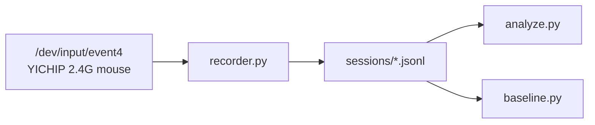

# MouseScrollFixer — Wiki

> Entries cite their evidence as `t3:<thread_id>` (open with `t3_thread_read`), `antigravity:<conv-id>` (`~/.gemini/antigravity*/brain/<conv-id>/`), a commit hash, or `code`. If an entry is vague, conflicts with another entry, or does not match what you see, open its source before trusting either.

Goal: suppress wrong-direction wheel ticks in real time, most of all the "end of scroll reverse", with a rule or a tiny model placed between the evdev device and the compositor.

## File map

| File | Role |
|---|---|
| [recorder.py](file:///home/joseph/Projects/Repos/MouseScrollFixer/recorder.py) | curses UI; a reader thread on the evdev fd; modes `d`/`u`/`s`/`r` |
| [analyze.py](file:///home/joseph/Projects/Repos/MouseScrollFixer/analyze.py) | Per-session stats: against-intent rate, bursts, reversal delays, cue reaction |
| [baseline.py](file:///home/joseph/Projects/Repos/MouseScrollFixer/baseline.py) | Hold-and-confirm rule filter, grid over M (notches) × W (ms) |
| `sessions/` | The dataset. One JSONL file per recording |

## Fast path

- Access: `sudo setfacl -m u:$USER:r /dev/input/event4`, a read-only ACL on that node only. It is lost on replug or reboot. The user is deliberately **not** in the `input` group, because that group can read the keyboard too. *(Source: t3:1139490a-2822-4da5-b9ab-0c6bf8b3304d)*
- Stable path: `/dev/input/by-id/usb-YICHIP_2.4G_Receiver_b120300001-if01-event-mouse`. The `-event-if01` sibling is the consumer-control interface (event6), not the mouse.
- Quick probe without the UI: `python3 -c "import recorder,time; r=recorder.Reader(recorder.DEVICE); r.start(); r.start_session(armed=False); time.sleep(3); print(len(r.stop_session()))"`

## Domain terms

| Term | Definition |
|---|---|
| report | One evdev `REL_WHEEL` event. The receiver polls every ~8 ms and can pack several notches into one report (seen −7…+5). |
| notch | `abs(REL_WHEEL value)`. The unit of scroll distance. |
| hi-res | `REL_WHEEL_HI_RES` (code 11). **Fake on this mouse**: always exactly 120 × `REL_WHEEL`. It adds no information. |
| stroke | One finger flick: ~5 reports over ~80 ms, followed by a 200–300 ms gap while the finger repositions. |
| burst | Analyzer unit: ticks separated by a gap of > `PAUSE_NS` (150 ms, a guess to retune). |
| jitter / wrong tick | A report whose sign is opposite to the intent of a `down`/`up` session. |
| end-of-scroll reversal | Wrong ticks trailing the last good tick of a burst, before the pause. |
| intent | `down`/`up` session mode, or for `sequence` the cue active at that time. Cues lead the real reaction by ~380–520 ms. |

## Invariants

- `REL_WHEEL > 0` means up (away from the user). *(Source: code)*
- Event and cue timestamps share `CLOCK_MONOTONIC`: the device fd is set with `EVIOCSCLOCKID`, and cues use `time.monotonic_ns()`. Do not mix in `time.time()`. *(Source: code)*
- Session files are never rewritten. Fix labels in the analysis code instead. *(Source: t3:1139490a-2822-4da5-b9ab-0c6bf8b3304d · f753d43)*
- Recording and analysis use the standard library only. *(Source: t3:1139490a-2822-4da5-b9ab-0c6bf8b3304d)*
- In free `d`/`u` sessions the user scrolls in bursts and pauses at will. Pauses are detected from tick gaps, not cued or timed (user's explicit choice). *(Source: t3:1139490a-2822-4da5-b9ab-0c6bf8b3304d)*

## Findings so far (4 sessions, 2026-11-23)

| Finding | Value |
|---|---|
| Wrong reports while scrolling down / up | 20% / 10% (asymmetric) |
| Wheel events at rest, finger on wheel | 0: jitter only happens during rotation |
| Wrong-run length | ~70% single report; runs up to 5 reports / 7 notches; single wrong reports of 2–4 notches are common |
| End-of-scroll reversal delay after last good tick | median 16–17 ms, mostly < 70 ms, outliers ~150–200 ms |
| Possible finger-release springback | a +3 kick ~386 ms after the last stroke at STOP |
| Best rule baseline (M=4, W=80) | still passes 19% of down jitter and 38% of up jitter, adds ~43 ms on real reversals |

Conclusion so far: a notch-count threshold cannot separate the two, because jitter is bursty and multi-notch. The model should use timing features (gap before and after, position within the stroke, stroke speed). *(Source: t3:1139490a-2822-4da5-b9ab-0c6bf8b3304d)*

## Historical issues

### Enter / q ignored while recording
* **Symptom**: Enter and `q` did nothing while recording. The session saved about a minute later.
* **Reasoning trace**: scrolling the wheel over the terminal makes the terminal emit arrow or mouse escape keys. The loop read one key per 16 ms frame, so Enter sat behind hundreds of queued keys.
* **Resolution**: `pending_keys()` drains the whole queue each frame, and the menu flushes leftover keys on return.
* **Source**: t3:1139490a-2822-4da5-b9ab-0c6bf8b3304d · f753d43

### Impossible reaction times in `sequence` analysis
* **Symptom**: 28–36 ms "reaction", and negative delays in the STOP row.
* **Reasoning trace**: the analyzer took the first tick pointing the cued way as the reaction. A jitter tick pointing that way counts too. In STOP, wrong ticks mixed into the late ticks still going the old way were counted as end reversals.
* **Resolution (pending)**: define reaction onset as the first run of ≥ 3 consecutive reports in the cued direction (`baseline.py` already does this). Count only opposite ticks after the last good tick as reversals.
* **Source**: t3:1139490a-2822-4da5-b9ab-0c6bf8b3304d
